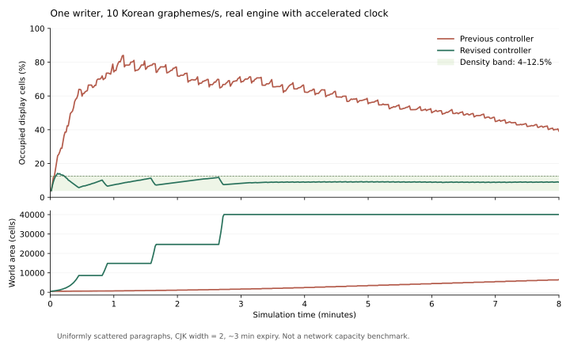

# 밀도와 크기 조절 재설계 — 2026-11-03

## 판단

이전 로직은 합리적인 밀도 제어기가 아니었다. 상한을 넘었는지만 확인하고 작은 변경을 10초마다 한 번 수행했으며, 변경량·간격을 실제 공간 부족량과 연결하지 않았다. 안전한 한 칸 후보가 발견되면 그것만 적용하기도 했다. 따라서 입력 속도보다 면적 증가가 느릴 수 있었다. 행별로 독립적인 무작위 경계를 골라 문맥을 흐트러뜨렸고, 모든 참여자의 입력 문맥을 매번 초기화했다.

상한을 25%에서 12.5%로 낮추는 것만으로는 이 결함을 해결할 수 없다. 실제 이전 버전의 제어기를 사용한 재현에서도 초당 한글 10자를 계속 기록하면 8분 중 477초가 상한 밖이었다.

## 비교한 구조

| 대안 | 장점 | 판단 |
| --- | --- | --- |
| 임계값만 조정하고 기존 고정 주기·작은 단계 유지 | 변경 범위가 작음 | 부하 추종과 문맥 파괴를 해결하지 못해 폐기 |
| 목표 면적으로 즉시 확대하고 모든 좌표를 비례 배율로 이동 | 밀도 오차를 즉시 줄임 | 글 사이가 세계 전체에서 벌어지고 순간 변화가 커서 폐기 |
| 안정적인 셀 ID와 지역 패치 그래프로 토러스 구성 | 먼 지역의 확장을 좌표 변경 없이 국소화할 가능성 | GPS·직사각형 시야·한 칸 이동·CJK 인접성·프로토콜을 모두 다시 정의해야 한다. 장기 대안으로 남김 |
| 목표 밀도 제어 + 연결된 공백 경로 + 국소 이동 검증 | 현재 토러스와 트랜잭션 의미를 유지하며 밀도와 연속성 개선 | 이번 구현으로 선택 |

## 제어 규칙

표시된 글자의 실제 칸 수 `L`과 세계 면적 `A`를 사용한다. 반각 1칸, CJK 등 전각 2칸이며, 공백·삭제 흔적·접속만 한 사람 수는 점유량에서 제외한다. 덮어쓰기·삭제 트랜잭션이 성공한 뒤에만 점유 카운터를 갱신하고 재시작 때 복구한다.

- 평상시 범위: **4%~12.5%**, 조절 목표 **8%**. 이 숫자는 실험용 운영값이다.
- 매초 판단한다. 최근 순점유 변화율을 5초 시간상수로 평활하고, 양의 순증가율에 대해서만 10초분 공간을 미리 확보한다. 같은 자리를 반복 덮어쓰는 요청 수를 성장량으로 세지 않는다.
- 예측 점유율이 12.5%를 넘으면 성장 작업을 시작한다. 목표 면적은 `(점유 칸 + 양의 순증가율 × 10초) / 0.08`이다.
- 한 번의 변경은 **한 축, 현재 면적의 최대 12.5%**다. 목표까지 매초 작은 변경을 반복한다. 목표에 도달한 **성공한 커밋에서** 성장 작업을 끝낸다. 다음 글자 때문에 목표를 매초 쫓는 상태에 머무르지 않는다.
- 낮은 밀도가 30초 이어져야 축소를 시작한다. 이후 5초마다 목표 쪽으로 줄인다. 새 글이 늘면 축소를 중단하거나 성장으로 전환한다. 오래된 목표를 끝까지 강행하지 않는다.
- 가로:세로 2:1 근처를 선호하며 1:1~4:1 안에서 조절한다. 보존하기 쉬운 한 방향으로만 길어지는 현상을 막는다.
- 실제 공간 한도는 여전히 32×16~1024×512다. 한도에 막힌 상태는 계측한다. 빈 세계의 밀도를 4%로 만들거나 무제한 부하를 이 면적 안에 수용할 수는 없다.

급격한 동시 유입이나 한 번에 허용된 입력 묶음은 일시적으로 상한을 넘길 수 있다. 상한은 모든 순간에 강제로 지키는 쓰기 거부 규칙이 아니라, 피드백 제어가 돌아갈 범위다. 작은 세계에서 갑자기 10명의 쓰기가 시작되는 재현에서는 처음 최대 43.9%까지 올라갔고 상한 밖 구간은 총 32초였다.

## 공간 재배치

각 행·열이 독립적으로 경계를 고르던 자동 경로를 교체했다. 무작위 시드로 시작 위치를 정한 **연결된 띠 모양 경로**를 세계의 반대편까지 찾고, 마지막과 첫 행·열의 연결도 평가한다. 좌표 0에 고정하지 않으며 완전히 직선인 경로는 가장 손상이 적은 곳에서 굽힌다. 서로 붙은 문단은 가급적 함께 평행 이동한다.

경로 비용은 삭제되는 글자, 끊기는 인접 관계, 가까운 공백 순으로 고려한다. 축별 두 후보를 제한된 비용으로 탐색하고, 실제 remesh 결과에서 손실·인접 관계·CJK 쌍을 검사한다. 큰 빈 띠를 지울 수 없다면 더 작은 공백 단계부터 시도한다. 보존 후보가 없으면 요청된 단계의 손실이 적은 후보를 적용한다. **보존 실패로 무기한 보류하는 경로는 없다.**

경로 탐색은 한 후보당 면적에 비례하는 동적 계획법이다. 시작점을 제한하므로 전역 최적 경로 또는 모든 공백 경로의 존재 여부를 증명하지 않는다. 문맥은 공간 인접성과 근처 공백으로 추정하며 언어적 의미를 완전히 이해한다는 뜻은 아니다. 강제 변경에서는 글자가 분리되거나 사라질 수 있다. CJK는 반쪽 상태로 남기지 않는다.

이전 `scattered-blank-v2`와 `coordinated-blank-v3` 저수준 remesh는 이전 사건 재현·비교와 직접 크기 변경 테스트를 위해 남는다. 운영 자동 조절은 `coherent-band-v4` 경로만 사용한다. 외부 참여자는 임의 크기 변경 권한을 갖지 않는다.

## 사용자에게 보이는 변화와 입력 경계

변경 전의 제한된 시야, 빈 주소, CJK 가장자리, 최근 입력 주소가 모두 동일한 평행 이동을 하는지 서버가 확인한다. 증명되는 WebSocket 참여자에게는 자기 지역의 이동량만 보내고, 브라우저는 지도 픽셀·망점·작성 기준 열·native UTF-16 문맥·진행 중인 조합을 함께 보존한다. 세계 전체의 경로나 보이지 않는 글은 보내지 않는다.

변경 경로를 가로지르는 시야, 세계 경계를 반복해서 보여주는 작은 세계, 보존 범위를 벗어난 입력 문맥, 미확정 입력은 보수적으로 초기화한다. 새 epoch 전에 보낸 쓰기는 여전히 거절한다. 다른 좌표로 추정해서 재전송하지 않는다. SQLite의 셀 재배치·메타데이터·사건 기록이 한 트랜잭션으로 성공한 뒤에만 커서·문맥을 바꾼다. 실패하면 모두 이전 상태다.

HTTP/MCP는 다음 관측에서 새 좌표의 reset을 받는다. 실행 중인 turn은 epoch 경계에서 멈추고 완료된 부분을 보고한다. WebSocket의 국소 화면 보존이 봇에게 오래된 좌표 쓰기 권한을 추가하지 않는다.

## 왜 큰 세계에서는 안정되는가

평균 신규 점유 속도를 `r`, 실제 글 수명을 `τ`라고 하면, 일정한 부하의 생존 글은 대략 `L ≈ rτ`로 수렴한다. 덮어쓰기와 삭제가 많으면 더 작다. 면적이 그 양에 맞춰지면 순증가율은 0 근처가 되고, 조절할 이유도 사라진다.

목표 8%에서 상한 12.5%까지의 여유는 면적의 4.5%다. 20만 칸 세계라면 예측 여유를 제외하고 약 9천 칸의 **순증가**가 있어야 다시 상한에 닿는다. 작은 입력량마다 전체를 조절하는 구조가 아니다. 실제로 재배치하더라도 고정 크기 시야가 경로를 만날 비율은 보통 세계 크기가 커질수록 작아진다. 특정 사람·장소의 최악 경우까지 이를 보장하지는 않는다.

전역 밀도와 국소 밀도는 다르다. 사람들이 한 장소에 모이면 그곳은 빽빽할 수 있다. 문맥 보존을 위해 그 장소의 모든 글을 균등하게 벌리는 정책을 넣지 않았다. 두 밀도를 따로 계측해 후속 판단의 근거로 삼는다.

## 실행한 실험

실제 엔진·SQLite·CJK 재배치·3분 만료를 사용하고, 시계만 가속했다. 글은 시드가 고정된 균등 분포 위치에 입력하고 매초 입력·만료·조절 후 샘플링한다. HTTP 제한이나 네트워크 비용을 포함한 서비스 수용량 시험이 아니다. 이전 제어기의 무작위 경로 선택은 고정되지 않으므로 이전 결과는 해당 1회 실행의 측정값이다.

| 조건 | 최대 밀도 | 12.5% 초과 시간 | 마지막 2분 밀도 | 마지막 2분 크기 변경 |
| --- | ---: | ---: | ---: | ---: |
| 이전, 1명 × 한글 10자/초, 8분 | 84.0% | 477초 | 39.1~52.0% | 12회 |
| 새 방식, 같은 부하·시간 | 14.14% | 8초 | 8.75~9.10% | 0회 |
| 새 방식, 10명 × 한글 5자/초, 8분 | 43.9% | 32초 | 8.59~8.83% | 0회 |

새 방식의 두 지속 입력 실험에서 resize에 의한 글자 손실은 0칸이었다. 인접 관계 분리는 각각 0·8건이었다. 2명 × 10자/초로 4분간 쓰고 멈춘 별도 10분 실험은 만료·점진적 축소를 거쳐 32×16으로 돌아왔다. 최소 크기에서 밀도는 0%다.



80×24 시야를 1,000곳씩 샘플링한 기하 실험에서 한 번의 확장 뒤 픽셀 위치를 보존할 수 있던 비율은 128×64에서 7.9%, 256×128에서 31.4%, 512×256에서 63.1%, 896×448에서 75.9%였다. 이전의 행별 독립 경로는 이 표본에서 0%였다. 이는 문단 배치가 정해진 기하 실험이며 실제 사용자 행동 통계가 아니다.

실시간 Chromium 두 창에서는 60번의 한·중 입력이 전부 저장됐고, 자동 확장 16회, 관측 최대 밀도 11.33%, 최종 8.32%, 페이지 오류 0이었다. 오래된 epoch 요청 1건은 정상 거부됐다. 별도 두 창 시험은 원거리 확장 전후 Canvas 데이터가 동일하고, 진행 중인 한글 조합 및 앞글자 재변환이 새 좌표에 정확히 커밋되는 것을 확인했다.

재현 명령:

```sh
npm test
npm run test:topology
node tests/density-live.mjs
npm run experiment:density
# 이전 제어기를 비교하려면 experiments/density.mjs의 준비 주석 참고
node experiments/density.mjs --baseline --quick
```

집계는 [측정 JSON](measurements/density-2026-11-03.json)에 보존한다. 실행별 상세 시계열과 스크린샷은 gitignored `artifacts/`에 있다.

## 남은 위험과 다음 실험

전체 셀 재저장·전역 epoch·단일 writer는 유지된다. 20만 칸 수준의 로컬 실험에서 조절 1회의 최대 실행시간은 약 243ms였다. 운영 디스크와 참여자 전파 비용은 별도로 검증해야 하며 선형 scale-out이나 최대 수용 인원을 입증하지 않는다.

만료는 여전히 5초마다 최대 500개 글자를 처리하므로 초당 약 100개보다 많은 지속적인 신규 glyph에는 정리 적체가 생길 수 있다. 그때 `τ`가 늘어나고 필요한 면적도 커진다. 현재 최대 면적과 함께 수렴 가정의 명시적 한계다. 다음 실험은 참여자 유입·이탈과 만료 적체를 함께 주고, 전역/시야 밀도·조절 비용·실제 입력 문맥 초기화 빈도를 비교하는 것이다. 큰 세계의 계획 계산을 writer 밖으로 옮기려면 계산 중 입력을 반영하는 커밋 검증부터 설계해야 한다.
