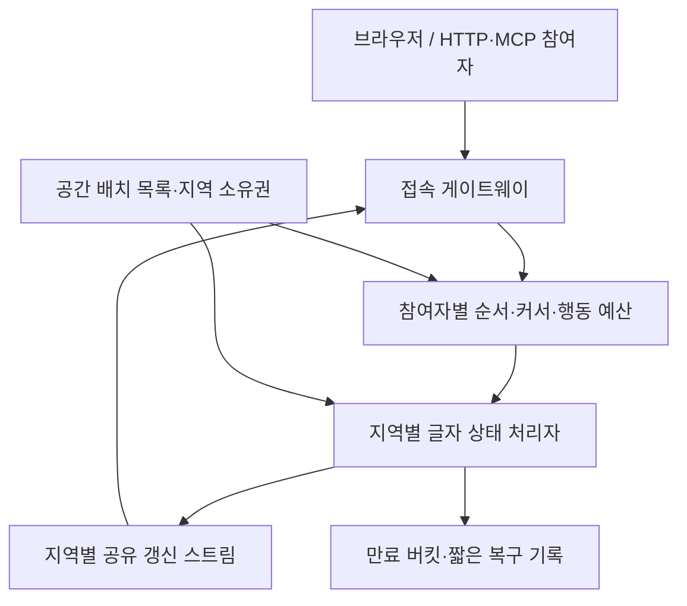

# Textworld의 분산 세계 설계

작성: 2026-11-16. 상태: **구조 제안과 의미 모형 검증 완료, 분산 서버 구현·처리량 검증 전**. 제품 헌법과 운영 코드는 변경하지 않았다.

## 1. 출발점: MMO의 한 세계, 여러 처리자

Textworld를 공간별 상태를 처리하고 주변 참여자에게 갱신을 보내는 서비스로 설계한다. MMORPG의 지역 서버, 관심 영역(AOI), 서버 틱, 경계의 읽기 복제본, 연결을 유지하는 권한 인계를 기본 틀로 사용한다. 서버 배치가 사용자가 보는 방이나 채널이 되지 않도록 한다.

이 세계에 필요한 것은 칸의 현재 글자·주변 커서·네이티브 입력·짧은 수명이다. 전투 물리, 아이템 소유권, 문장 전체의 영구 이력, 세계 전체의 입력 총순서는 요구되지 않는다. 글자와 장소가 사라져도 되므로 모든 재배치를 영구적인 주소 보존 문제로 만들 필요도 없다.

목표는 참가자와 살아 있는 상태가 늘면 처리자도 늘려, **처리자당 입력량·상태량·구독 전송량을 일정 범위에 유지**하는 것이다. 현재 서버의 함수를 빠르게 만드는 계획과 구분한다. [현재 코드 측정](CAPACITY_2026_11_16.md)은 바꿀 책임 경계를 찾기 위한 근거로 남긴다.

## 2. MMO에서 가져오는 것과 선택하지 않는 것

| 방식 | Textworld에 적용한 판단 |
| --- | --- |
| 지역별 상태 처리 + AOI | 채택. 보이는 주변 지역만 구독한다. 지역은 부하에 따라 나누고 다른 서버로 옮긴다. |
| 지속적인 지역 복제 목록, 휴면 객체 | 채택. 정지한 글자는 덮어쓰기·만료·배치 변경 때만 갱신한다. 매 참여자마다 모든 글자를 다시 검사하지 않는다. |
| 서버 틱 + 클라이언트 예측 | 채택. 내 입력·카메라는 즉시 예측하고, 공유 상태는 일정 주기로 수렴시킨다. 원격 커서는 보간한다. |
| 경계 복제본과 권한 인계 | 채택. 근처 지역을 미리 구독하고, 접속은 유지한 채 처리 책임을 바꾼다. 복제본을 새 쓰기 권한으로 취급하지 않는다. |
| 채널/인스턴스별 세계 복제 | 기본 공개 세계에는 채택하지 않는다. 같은 장소에서 서로 다른 글자를 보는 별개 세계가 된다. 향후 private world는 별도 문제다. |
| EVE식 시간 지연(TiDi) | 기본 과부하 해결책으로 채택하지 않는다. 실시간 대화·네이티브 입력·약 3분 만료의 시간을 부하에 따라 늘리지 않는다. |
| 거대한 지역 하나를 강한 단일 서버에 배치 | 최종 구조로 채택하지 않는다. 한 지역이나 한 칸의 집중 부하를 처리자 추가로 분해할 수 있어야 한다. |
| 모든 셀 변경을 하나의 전역 로그/합의 그룹에 기록 | 채택하지 않는다. 관계없는 장소의 타이핑을 서로 기다리게 한다. |

Epic의 Replication Graph는 클라이언트마다 객체를 전부 평가하는 대신 지속적인 공간별 목록을 공유한다. 이것은 복제 목록 계산 방법에 대한 근거이지 분산 서버 처리량의 증명은 아니다. coherence의 권한 이전은 권한과 연결의 분리를 참고하되, Textworld의 쓰기 권한은 서버에 둔다. CCP의 2011년 TiDi 설명은 밀집 지역의 무제한 수용을 약속하는 자료가 아니라 과부하 시 동작을 정의해야 한다는 근거다. 출처는 마지막 절에 있다.

## 3. 책임을 세 층으로 분리한다



### 접속과 참여자

한 참여자의 입력 순서, 현재 커서, 작성 기준, 최근 native 편집 범위, 행동 예산은 그 참여자의 작은 상태 기계가 담당한다. 참여자 ID를 기준으로 여러 처리자에 분산한다. 브라우저 연결과 지역 서버는 일대일로 묶지 않는다.

이 상태에는 단일 유효 소유자와 증가하는 인계 번호(fencing epoch)가 필요하다. 복제된 참여자 파티션에 `session/sequence`와 계획 결과를 짧게 보관하고, 권한을 잃은 처리자는 새 입력을 확정하지 못한다. 하나의 참여자가 모호한 두 커서에서 동시에 쓰는 것을 막는 좁은 합의다. 세계 전체의 쓰기에는 합의하지 않는다.

### 지역의 글자 상태

세계에 작은 저장 블록을 충분히 많이 두고 한 서버가 여러 블록을 맡는다. 서버를 늘리면 블록의 처리 책임을 이동한다. 블록 크기와 서버 수는 별개다. 화면에서 가까운 블록은 같은 처리자에 묶어 통신을 줄일 수 있지만, 혼잡하면 분리한다.

지역 경계에서는 한 글자의 폭과 관측 경계 보정에 필요한 작은 읽기 복제본을 둔다. 정상 쓰기는 참여자 처리자가 허용한 현재 커서·native 범위에서만 생긴다. 접속자가 블록 ID를 안다고 임의 쓰기나 전체 조회 권한을 얻지 않는다.

### 배치와 소유권

세계의 가로·세로 크기, 좌표가 가리키는 칸, 각 블록의 처리 서버를 관리한다. 배치 변경 빈도는 제한하며 개별 타이핑은 이 제어 경로를 통과하지 않는다. 제어 계층 장애 중에도 유효한 기존 배치와 소유권 안의 작업은 계속할 수 있다. 안전한 새 소유권을 얻지 못한 영역은 명시적으로 사용 불가가 되며 다른 지역을 멈추지 않는다.

## 4. 저장 주소와 세계 좌표를 분리한다

선택한 기본 표현은 다음과 같다.

```text
PlaceID = (저장 블록 ID, 블록 안의 슬롯)
Glyph   = (작업 ID, 글자, 1~2개의 PlaceID, 순서 표식, 만료 버킷, 작성자 색 참조)
Layout  = (배치 버전, W, H, 좌표 ↔ PlaceID 인덱스)
```

`(x,y)`는 현재 배치의 위치이고 `PlaceID`는 저장된 칸의 주소다. 사용자는 가로·세로가 일정한 문자 격자와 토러스를 본다. 조각마다 길이나 이동 규칙이 다른 비정형 표면을 사용자에게 드러내지 않는다.

배치 인덱스는 공간별 페이지로 분할한다. 보통은 직사각형 범위 참조로 압축하고, 조각이 많아진 페이지는 고정 크기 슬롯 배열로 펼친다. 예를 들어 32×32 페이지는 최악에도 1,024개 주소로 조회 비용을 제한할 수 있다. 빈 공간은 범위와 생성 규칙으로 표현하고, 실제 쓰기 전에는 글자 객체를 만들지 않는다. 저장 블록/페이지 크기는 실험값이며 고정 제품 규칙이 아니다.

이 표현은 확대·축소 후 데이터베이스의 모든 글자를 새 좌표로 다시 쓰지 않아도 된다. 인덱스 조회, 인덱스 갱신, 조각 관리 비용은 여전히 존재한다. 그것을 없다고 가정하지 않고 분산 가능한 별도 작업으로 만든다. 페이지의 과거 변환 목록을 무제한 따라가는 설계는 허용하지 않는다.

비교한 대안:

- 절대 좌표를 저장 키로 사용: 단순하지만 세계 크기 변경과 데이터 이동이 결합한다.
- 행/열마다 영구 ID를 주는 두 개의 순서열: 전체 행/열 삽입은 간단하지만 휘어진 분산 경로와 두 축의 연속 변경을 충분히 표현하지 못한다.
- 비정형 타일을 이웃 링크만으로 연결: 지역 확장은 쉽지만 균일한 xy 스크롤·행 정렬·GPS 투영의 의미가 복잡해진다.
- **분할된 직사각형 좌표 인덱스 + 별도 저장 주소:** 선택. 격자 의미를 보존하는 대가로 인덱스의 분산 갱신과 조각 관리라는 검증 과제를 명확하게 맡는다.

## 5. 확장·축소는 배치 사건이다

가로 확장은 각 행에서 선택한 경계에 새 빈 칸을 넣어 최종 너비를 같게 한다. 경계는 이웃 행끼리 연결된 무작위 경로로 잡아 0점의 긴 직선을 만들지 않는다. 세로 확장은 각 열에 같은 원리를 적용한다. 축소는 선택한 칸들을 배치에서 제외한다. 마지막 배치는 항상 W×H이고 양 축이 감긴다.

경로 탐색은 여러 구간으로 나누고 공통으로 정한 접점 사이에서 수행한다. 지역 글자 배치로 공백과 문맥 보존 점수를 계산한다. 큰 공백 변경을 먼저 시도하고, 더 작은 변경도 제한된 예산 안에서 시도한다. 보존 후보가 없거나 계획 시간이 끝나면 파괴를 허용한 경로로 반드시 진행한다. 입력이 계획 후 공백에 들어왔다고 세계 전체의 확장을 취소하지 않는다.

실행 절차:

1. 계층적으로 합산한 표시 칸 수·만료량·순증가로 다음 목표 면적을 정한다. 매 입력마다 중앙 카운터를 갱신하지 않는다.
2. 작업자들이 새 인덱스 페이지를 준비한다. 새 빈 칸 ID는 배치 버전과 경로에서 결정적으로 생성한다. 기존 글자 저장소는 계속 쓰기를 받는다.
3. 준비된 새 배치를 가리키는 작은 manifest를 확정한다. 누락 구간을 포함한 불완전 배치를 공개하지 않는다. 구간 탐색 지연에는 사전에 정의한 결정적 강제 경로를 쓸 수 있다.
4. 참여자는 현재 `PlaceID`를 새 배치에서 찾는다. 살아 있으면 같은 칸을 유지하고 카메라 기준만 보정한다. 삭제됐으면 정해진 살아 있는 이웃으로 보정한다. IME의 DOM은 브라우저가 계속 소유한다.
5. 사라진 주소의 글자·잘린 CJK 묶음은 퇴역 처리한다. 이전 배치와 재전송을 위한 정보는 제한된 유효 기간 뒤 제거한다.

중요한 경계: manifest 확정에는 짧은 메타데이터 합의가 있지만, 모든 참여자의 입력을 모아 잠그거나 ACK를 기다리지 않는다. 삭제와 경합한 글자가 사라지는 것은 정상 세계 사건이다. 현재 주소를 쓰게 하는 규칙과 커서 보정은 참여자 처리자가 책임진다.

인덱스 준비가 세계 크기에 비례하는 경우도 있다. 이 작업을 페이지별로 분할하면 총량은 세계 크기에 선형이며 서버마다 맡은 페이지 수를 일정하게 유지할 수 있다. **하나의 프로세스가 모든 페이지를 모으거나 다시 복사하는 구현은 이 설계를 위반한다.** manifest 합성은 트리로 처리하고, 조회는 현재 시야와 이웃 페이지를 캐시한다. 전역 배치 준비의 지연·장애·콜드 조회의 로그 비용은 실제 분산 실험으로 확인해야 한다.

## 6. 덮어쓰기는 합칠 수 있는 현재 상태로 만든다

전투 판정이나 재고 차감과 달리, 같은 칸의 중간 글자가 나중 글자로 덮여 사라지는 것은 정상 동작이다. 따라서 모든 독자가 모든 중간 쓰기 사건을 받도록 하지 않는다.

비교한 방식은 지역 단일 writer의 엄격한 순서, 위치마다 분산 합의, 서버가 부여한 순서 표식으로 합치는 칸별 레지스터다. 공개 세계에는 **마지막 방식을 제안**한다. 참여자 자신의 입력 순서와 인과관계는 보존하고, 서로 보지 못한 동시 입력에는 결정적인 승자를 정한다. 세계 전체의 벽시계 순서나 문장 전체의 원자성을 제공하지 않는다.

서버가 HLC와 고유 발행자/작업 ID로 순서 표식을 발급한다. 클라이언트는 우선순위나 미래 시각을 제출할 수 없다. 이미 관측한 글자보다 뒤의 쓰기에는 더 큰 인과 표식을 사용한다. 각 칸에는 가장 큰 표식의 주장만 남긴다. `max` 병합은 순서·중복·중간 집계에 영향을 받지 않는다.

클라이언트가 전달하는 관측 버전도 서버가 실제로 전달한 시야의 증거와 대조한다. 임의의 큰 버전을 제출해 우선순위를 올릴 수 없어야 한다. 순서 표식의 크기·유효 시간과 발행 권한은 내부 프로토콜이 검증한다.

두 칸 글자의 표시 조건은 **그 글자가 두 칸 모두에서 현재 승자이고, 현재 배치에서도 두 칸이 인접할 것**이다. 한쪽만 더 새 글자로 덮이면 옛 두 칸 글자는 통째로 보이지 않는다. 수신이 잠깐 한쪽만 끝난 경우에도 반쪽 문자를 그리지 않는다. 삭제 표식과 오래된 작업 거부 기준으로 과거 글자가 부활하지 않게 한다. 배치 때문에 갈라진 글자에는 퇴역 표식을 남겨, 나중에 우연히 다시 붙더라도 되살리지 않는다.

IME는 브라우저가 확정한 편집 범위 한 묶음으로 수락한다. 자모 키 입력을 별도 글자로 해석하지 않는다. 이후 공간 상태는 글자 단위로 합류한다. 여러 글자로 된 문장 전체가 모든 지역에서 한순간에 바뀌어야 한다는 계약은 추가하지 않는다.

한 칸에 쓰기가 집중되면 게이트웨이별로 같은 틱의 승자를 먼저 합치고, 고정 fan-in 트리에서 다시 합친다. 입력 검증과 행동 예산 소비는 합치기 전에 모든 요청에 적용한다. 상위 처리자 하나가 N명의 원시 요청을 모두 받는 구조를 피한다. 이 방식은 글자의 최종 상태를 합치는 것이며 사용자가 보낸 입력이 반드시 다른 사람의 화면에 한 번 나타났다는 보장은 하지 않는다.

## 7. 구독과 서버 틱

한 참여자는 현재 커서 주변의 제한된 시야와 작은 이동 여유 영역만 구독한다. 지역은 공유 변경 스트림을 한 번 만들고, 게이트웨이들이 나눠 전송한다. 초기 화면은 snapshot, 이후는 변경분이다. 늦은 소비자에게 오래된 모든 중간 패킷을 끝없이 쌓지 않고 현재 snapshot으로 수렴시킨다.

첫 검증값은 글자 갱신 20Hz, 원격 커서 10~20Hz다. 입력 자체를 50ms 동안 브라우저에서 기다리게 하지 않는다. 내 글자와 카메라는 즉시 예측하고 공유 상태와 나중에 맞춘다. 틱마다 전체 세계를 순회하지 않고 변경된 지역만 처리한다.

데이터 전송은 계층적인 공유 스트림을 사용한다. 지역 처리자에 모든 사용자 소켓을 직접 연결하지 않는다. 게이트웨이가 내부적으로 받은 블록도 사용자에게는 허용된 범위와 CJK 경계 보정만 잘라서 제공한다. 공유 캐시가 시야 제한을 우회하는 API가 되면 안 된다.

## 8. 밀집 지역의 커서가 선형성의 제품 경계다

시야 면적 V가 고정이면 표시할 글자 상태의 크기도 제한할 수 있다. 같은 칸의 무수한 덮어쓰기도 최신 승자로 합칠 수 있다. 하지만 한 장소에 N명이 모여 서로의 **개별** 커서를 일정 빈도로 모두 받으면 수신해야 하는 정보량이 N×(N−1)이다. 지역 서버를 더 나누거나 중계 서버를 넣어도 최종 전송량은 사라지지 않는다.

따라서 두 보장 범위를 구분한다.

- **개별 커서 표시 계약 유지:** 공간적으로 분산되고 한 시야 안의 인원이 제한된 경우에 선형 확장을 목표로 한다. 단일 초밀집 지역까지 선형이라고 주장하지 않는다.
- **초밀집 지역도 선형인 목표안:** 모든 점유 위치는 칸별 인원으로 표시하고, 가까운 개인 커서 등의 상세 표시는 고정 예산 K 안에서 제공한다. 혼잡도가 낮으면 전원 개별 표시하고 높으면 군중으로 표현한다. 군중도 사용자의 커서 위치에 존재하며, 사람과 봇은 같은 상세 예산을 받는다.

후자는 이 문서의 **권장 제품안**이다. 예를 들면 상세 커서 K=64와 칸별 인원 집계를 실험할 수 있다. 실제 집계도 참여자 ID별 위치 파티션과 고정 fan-in 집계 트리로 나눠야 하며, 한 서버가 밀집 지역의 모든 커서를 재계산해서는 안 된다.

다만 헌법 6항의 “Other users' cursors are visible in real time”를 개별 커서 전원 표시로 해석한다면 군중 집계는 승인할 제품 의미 변경이다. **현재 승인이 이루어졌다고 간주하지 않으며, 헌법 수정이나 집계 표시 구현은 하지 않았다.** 개별 전원 표시·무제한 밀집·고정 실시간 빈도·선형 총자원이라는 네 조건을 동시에 약속할 수 없다. 이 경계를 데이터베이스나 서버 엔진 선택으로 감추지 않는다.

## 9. 수명, 저장, 장애

각 글자에 정확한 벽시각을 반복 저장하지 않는다. 작업은 공유하는 만료 버킷을 참조하고 칸은 작업 ID를 참조한다. 새 쓰기는 현재 버킷으로 들어간다. 버킷 정리는 지역별 시간 예산과 큐로 분산한다. 글자 수가 늘어도 세계 전체에 고정된 초당 100글자 정리 제한을 두지 않는다.

현재 상태와 짧은 복구 기록만 유지한다. 중복 방지는 참여자 순번의 상한과 제한된 최근 결과로 처리하며, 모든 작업 결과·좌표 이력을 영구 보존하지 않는다. 만료된 버킷의 작업은 수신 단계에서 거부한다. 이 거부 기준보다 이른 tombstone은 제거할 수 있다. 장애 후 복귀한 서버는 현재의 유효 버킷과 배치를 확인한 뒤 참여한다.

서버 시계 오차와 최대 전달 지연을 무시하면 삭제된 글자가 부활할 수 있다. 허용 오차, 버킷 경계, 오래된 작업 거부 기준을 프로토콜로 고정하고, 기준을 따라가지 못한 처리자는 새 입력 발행을 중지한다. 약 3분 수명은 유지하고 내부 오차 범위를 명시한다.

초기 구현 후보는 Go의 파티션 worker, 내부 gRPC 스트림, 브라우저 WebSocket, 3개 복제본의 짧은 지역/참여자 상태, 소유권·manifest용 작은 합의 그룹이다. 합의 그룹 하나에 모든 글자·커서·접속 상태를 넣지 않는다. 글로벌 Kafka 토픽이나 전역 Redis 채널도 데이터 경로의 필수 중간 지점으로 만들지 않는다. 언어·저장 엔진은 실험 선택이며 공간 분할과 상태 계약보다 먼저 고정하지 않는다.

## 10. GPS와 봇은 같은 세계 규칙을 사용한다

GPS는 브라우저에서 경위도를 정규화된 좌표로 바꾸고 현재 배치의 W/H에 투영한다. 원래 위경도를 서버로 보내지 않는다. 초기안은 현재의 단순 경위도 투영을 유지한다. Mercator나 지리 셀 체계는 공간 왜곡이나 새 좌표 규칙을 가져오지만 서버 분산 자체를 해결하지 않는다. 지구 구면과 토러스의 거리·극점 의미가 동일하다는 보장은 하지 않는다.

배치 변경 후 GPS는 현재 세계의 해당 좌표를 가리킨다. 공유 위치는 살아 있는 PlaceID를 따라갈 수 있지만 그 장소가 삭제된 뒤의 영속성은 약속하지 않는다. 서버 지역을 옮기는 것과 GPS 착지점을 바꾸는 것은 별개다.

사람·HTTP 봇·MCP는 같은 참여자 처리자를 통과한다. 입력/이동/새로 노출된 칸의 예산, 시야, 조합 확정 크기, 군중 상세 예산을 공유한다. 분산 게이트웨이마다 제한이 새로 충전되지 않도록 참여자·네트워크별 예산을 분할된 권위에 두고 제한된 token lease를 사용한다. 봇의 여러 행동 예약은 통신 횟수만 줄이며 서버가 사람과 같은 시간에 실행한다. 과속 입력의 429는 유지한다.

## 11. 무엇이 선형인가

U=참여자, r=1인당 허용 행동률, V=최대 관측 칸, K=최대 개인 커서 상세 수, L=수명/복구 기록 보존 기간이라 하자. r·V·K·L과 복제 수를 일정하게 유지한다.

- 입력 검증과 참여자 상태: O(U·r), O(U).
- 살아 있는 글자·작업/삭제 정보: O(U·r·L) 상한. 실제로는 덮어쓰기로 줄어든다.
- 틱별 관측·전송: 최악 O(U·(V+K)). 갱신이 적으면 변경분만 전송한다.
- 적정 밀도 세계의 배치 인덱스: 면적에 선형. 페이지별 처리량을 분산한다.
- 단일 칸의 쓰기 폭주: 원시 검증 총량 O(U·r), 중간 상태 병합은 고정 fan-in 트리. 트리 깊이에 따른 통신 지연은 남는다.

이것은 일정한 작업·관측 예산 아래의 **자원 작업량 모델**이다. 처리량의 선형 증가를 이미 측정했다는 뜻이 아니다. 콜드 주소 조회, 소유권 인계, 배치 manifest 합성의 로그 비용과 네트워크·복제·장애 여유가 있다. 작업자가 늘어도 특정 지역 소유자, root manifest 작성자, 전역 broker 또는 군중 목록 생성자 하나에 데이터 작업이 모이면 선형성 주장을 철회해야 한다.

군중 집계 없이 K가 U와 함께 늘어나는 계약에서는 위 식이 U²로 바뀐다. 지역 구독만 넣었다고 그 사실이 달라지지 않는다.

## 12. 확인한 것과 다음 실험

[의미 모형](../experiments/distributed-model.mjs)을 실행해 9개 검사를 통과했다. 중복·역순 전달과 계층 병합의 결과 일치, 부분 덮어쓰기의 CJK 전체 제거, 만료 작업의 재유입 방지, 200회 가로/세로 분산 배치 변경의 직사각형 토러스·주소 유지, 삭제된 커서 보정, 갈라진 글자의 부활 방지, 꽉 찬 세계의 강제 변경을 확인했다. [결과](measurements/distributed-model-2026-11-16.json).

이 모형의 배치 인덱스는 단일 프로세스의 배열이고 순서 표식도 단순 정수다. 분산 인덱스, HLC, replica 장애, 권한 인계, 실제 IME, 처리량을 검증한 것이 아니다. 특히 배치 변경과 두 칸 글자의 퇴역 전파, 조각난 인덱스의 비용, 군중 집계 정책은 후속 검증 대상이다.

다음 작업은 기존 서버의 최적화가 아니라 **별도의 최소 분산 세계 실험**이다.

1. 지역 worker 2개와 게이트웨이 1개로 두 브라우저가 같은 세계를 쓰게 한다. 원격 지역 쓰기가 다른 지역의 처리 루프를 막지 않아야 한다.
2. 경계 CJK 덮어쓰기, 조합 중 지역 인계·확장·축소, 늦은 메시지·재전송·서버 중단을 주입한다. 입력 중단 대신 커서 보정이 작동하는지 확인한다.
3. worker 1/2/4/8개에 같은 단위 지역·참여자 부하를 배치한다. 처리량 효율 T(P)/(P·T(1)) 80% 이상, 지정한 내부 공유 지연 p95 100ms 이내를 첫 실험 목표로 둔다. 이는 측정 전 목표값이다.
4. 분산된 사용자, 한 지역 집중, 한 칸 집중을 별도 시험한다. 개별 커서 전원 표시와 군중 집계 모드의 비용을 따로 보고한다. 설정을 바꿔 한쪽 실패를 숨기지 않는다.
5. 만료와 반복 배치 변경을 함께 실행해 10분·1시간의 메모리/저장량이 안정되는지 본다. 죽은 과거 배치·작업·작성자 정보가 누적되면 구조를 다시 검토한다.

## 근거 자료

2026-11-16에 공식 본문을 확인했다. 아래 시스템의 제품 규모를 Textworld의 예상 수용 인원으로 가져오지는 않았다.

- [Epic — Replication Graph](https://dev.epicgames.com/documentation/unreal-engine/replication-graph-in-unreal-engine): 지속적인 공유 복제 목록, 공간별 관련성, 휴면 객체.
- [CCP — Introducing Time Dilation, 2011-04-22](https://www.eveonline.com/news/view/introducing-time-dilation-tidi): 밀집 부하에서 대기열이 늘어나는 문제와 의도적으로 정의한 저하 동작. 당시 설계 설명이며 현재 성능 수치가 아니다.
- [coherence — Authority transfer](https://docs.coherence.io/manual/networking-state-changes/authority/authority-transfer): 상태 처리 권한과 접속자의 분리, 비동기 인계 중 오래된 명령의 처리. 해당 SDK 채택을 의미하지 않는다.
