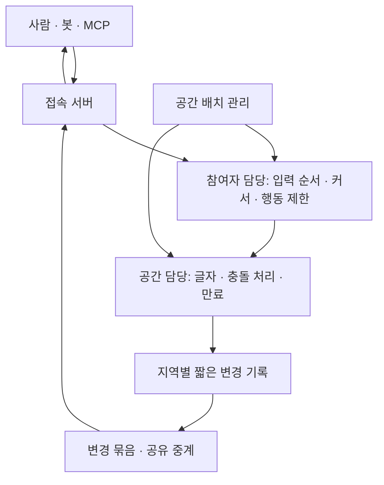

# Textworld 최종 설계 제안

작성: 2026-11-16. **설계 제안이며 운영 적용 완료 보고가 아니다.** 제품 헌법은 변경하지 않았다.

## 결론

현재 자료만으로 한 방식의 최적성을 입증하지는 못했다. **공통 구조는 하나로 정하고, 같은 칸의 동시 입력을 처리하는 방식만 두 안을 제시한다. 구현의 우선 권고는 A안이다.** 사용자에게 두 기술 중 하나를 골라 달라는 뜻은 아니다. A안을 기준으로 구현하고, 특정 칸의 입력 집중이 병목일 때 B안의 추가 복잡성이 실제 이득을 주는지 비교한다.

공통 구조는 **공간별 처리 + 시야별 구독 + 모든 변경의 짧은 묶음 전달 + 공유 중계 + 수명이 제한된 저장**이다. 사용자에게는 하나의 연속된 세계이며, 여러 서버가 담당한다고 방이나 채널로 나누어 보이지 않는다.

실제 Railway 인프라의 대응은 [Railway 수평 확장 배치안](RAILWAY_SCALE_OUT.md)에 있다. 볼륨 없는 접속 서버는 replicas로, 로컬 저장소가 필요한 세계 서버는 별도 서비스로 늘린다. 볼륨/replicas 제약과 sticky session 미지원, 수평 확장의 수동 설정을 반영한다. 현재 단일 앱의 replica 수만 변경하는 계획이 아니다.

A안은 각 지역의 담당 서버가 입력 순서를 정한다. B안은 여러 서버가 같은 장소의 입력을 받아 CRDT 규칙으로 결과를 합친다. 둘 다 접속자별 입력 검증, 원래 시야 제한, 봇의 429, 개별 커서, 약 3분 만료를 유지한다.

## 사용자가 경험할 동작

예를 들어 여러 사람이 같은 장소에서 글을 쓴다면 다음과 같이 동작한다.

1. 내 글자는 현재처럼 즉시 보인다. 한국어 조합은 OS와 브라우저가 처리한다.
2. 서버는 입력을 받는 대로 검증하고 처리한다. 다른 관측자가 확인할 때까지 기다리지 않는다.
3. 다른 사람의 화면에는 약 50ms 동안 생긴 **모든 공개 변경**이 한 묶음으로 도착한다. 같은 칸을 여러 번 덮거나 커서가 여러 번 이동해도 포함한다. 50ms는 첫 실험값이며 인터넷 전체 지연 보장이 아니다.
4. 수신자는 변경을 모두 적용한 뒤 화면을 그린다. `가 → 나 → 다`를 모두 받아도 각 글자를 따로 한 프레임씩 재생할 필요는 없다.
5. 정지한 글자와 커서는 반복해서 전체 목록을 받지 않는다. 실제 변경, 접속 상태 유지에 필요한 작은 신호, 최초 진입 화면만 전달한다.
6. 잠깐 연결이 끊기면 보관 중인 변경을 이어받는다. 보관 범위를 넘어가면 누락을 명시하고 현재 화면으로 관측을 재시작한다. 이를 완전 전달 성공으로 세지 않는다.

“모두 받는다”는 현재 허용된 시야에서의 정상 구독을 뜻한다. 전 세계 조회, 무제한 과거 이력, 개인 IME 초안 공개를 뜻하지 않는다. 수락된 입력은 모두 처리하되, 상태를 바꾸지 않은 명령까지 모든 관측자에게 공개할 필요는 없다. 화면에 나타날 중간 변경을 마지막 상태로 임의 대체하는 정책은 넣지 않는다.

## 공통 구조: 한 세계를 여러 담당자가 나누어 운영한다

| 담당 | 하는 일 | 늘리는 방법 |
| --- | --- | --- |
| 접속 서버 | WebSocket 유지, 시야 구독, 전송 | 접속자와 실제 전송량에 맞춰 추가 |
| 참여자 담당 | 한 사람의 입력 순서·현재 커서·허용 속도 | 참여자 ID로 분산 |
| 공간 담당 | 작은 공간 단위의 글자·덮어쓰기·만료 | 많은 작은 단위를 서버들에 배치하고 이동 |
| 중계 | 같은 변경 묶음을 여러 접속 서버에 전달 | 구독 지역과 출력량에 맞춰 계층적으로 추가 |
| 공간 배치 관리 | 크기와 좌표의 대응, 담당 서버 목록 | 작은 제어 정보와 분할된 좌표 페이지로 관리 |

처음부터 각각을 별도의 대형 서비스로 배포할 필요는 없다. 책임과 통신 경계를 먼저 나누고, 같은 프로세스에 두더라도 나중에 독립 배치할 수 있게 한다. 공개 세계 전체의 모든 쓰기를 하나의 로그·카운터·메시지 채널로 모으지 않는다.

### 시야만 동기화하고 계산 결과를 공유한다

게임 서버의 관심 영역 관리(AOI)를 사용한다. 서버는 각 참여자가 어느 작은 공간을 보고 있는지 관리하고, 변경된 공간의 구독자에게만 전달한다. 접속할 때와 시야를 이동할 때는 그 범위의 기준 화면을 받고 이후 변경을 이어받는다.

같은 공간을 보는 사람이 많으면 변경 본문을 공유한다. 작은 타일 전체가 허용 시야에 들어가면 공통 본문을 재사용하고, 시야 경계는 접속 서버에서 잘라낸다. 봇이나 브라우저에 내부 블록 전체를 보내서 숨기게 하지 않는다. 시야 필터링 때문에 제외한 순번과 실제 전송 누락을 구별한다.

매 입력마다 모든 사용자의 화면을 다시 계산하는 현재 구조를 없앤다. 단, 연결별 전송·암호화와 시야 경계 필터링의 비용은 남으며 실제 측정해야 한다.

### 사건 보존, 화면 갱신, 상태 수렴을 구분한다

다음 세 가지는 서로 다른 약속이다.

- **전달:** 정상 구독 중의 공개 변경을 빠짐없이 받는다. 묶음으로 보내고 중복 전송은 한 번만 적용한다.
- **표시:** 받은 변경을 적용한 결과를 화면에 그린다. 모든 중간 상태를 각각 화면에 노출할 필요는 없다.
- **수렴:** 같은 변경들을 반영한 사용자들이 같은 최종 세계 상태를 본다.

OT/CRDT가 수렴을 보장한다고 원래 입력 사건을 모두 전달했다는 뜻은 아니다. CRDT를 택해도 이 설계의 전달 계약은 유지한다. 압축과 중복 제거는 가능하지만 서로 다른 원본 변경을 마지막 값 하나로 바꿔 보냈다고 전체 사건 전달로 계산하지 않는다.

관측 묶음에는 스트림의 세대와 순번, 배치 버전, 변경 목록을 둔다. 시간 상한과 크기 상한을 함께 두고, 큰 묶음은 여러 프레임으로 나눈다. 한 지역/발행 파티션 안의 순서를 사용하며 세계 전체 입력을 정렬하지 않는다. 입력 ACK, 관측 지연, 화면 표시 지연을 별도로 측정한다.

## A안: 지역 담당 서버가 순서를 정한다 — 우선 권고

각 작은 공간에는 **현재 유효한 담당자 하나**가 있다. 여러 사람이 같은 칸에 쓰면 담당자가 처리한 순서대로 덮어쓴다. 다른 공간은 다른 담당자가 동시에 처리한다. 담당자는 물리적인 서버 한 대에 영구 고정되지 않으며 부하와 장애에 따라 이동할 수 있다.

### 선택 이유

- 공개 세계에는 서버의 입력 속도·위치 검증이 이미 필요하다. 그 결과를 지역 담당자가 확정하는 흐름이 단순하다.
- 문자 입력은 칸 덮어쓰기다. 문서의 앞에 글자를 삽입해서 뒤의 모든 위치를 보정하는 문제를 기본으로 갖고 있지 않다.
- 오프라인에서 문서를 오래 편집한 뒤 모든 편집 의도를 합치는 동작은 현재 공개 세계의 요구가 아니다.
- 동시 CJK 덮어쓰기, 만료 직전 재입력, 조합 중 커서 이동을 구체적인 처리 순서로 설명하고 검사하기 쉽다.
- 저장량을 현재 상태와 제한된 최근 기록으로 관리하기 쉽다. 영구적인 문서 변경 이력에 의존하지 않는다.

### 필요한 일관성의 범위

자기 입력의 순서는 참여자 담당자가 유지한다. 한 칸의 변경 순서는 공간 담당자가 유지한다. 서로 관계없는 지역의 입력에는 세계 전체 순서를 부여하지 않는다.

한글처럼 두 칸을 쓰는 글자는 한 덮어쓰기 단위로 확정한다. 양쪽 칸과 그 칸에 겹친 기존 글자의 칸만 함께 처리한다. 경계가 서로 다른 담당자에 걸치면 해당 소수의 칸을 조정하는 절차가 필요하다. 단순히 양쪽 서버에 따로 보낸 뒤 성공했다고 처리하지 않는다. 문장 전체나 세계 전체를 잠그지는 않는다.

운영용 권위에는 짧은 복제 로그와 소유권 세대가 필요하다. 새 담당자로 바뀌면 옛 담당자의 쓰기는 차단한다. ACK는 선택한 복구 보장에 맞춰 기록된 뒤 내보낸다. 첫 분산 검증에서 복제·경계 쓰기·장애 중단 범위를 확인하기 전에는 고가용성을 제공한다고 주장하지 않는다.

### 한계

지역을 계속 나누어도 **동일한 한 칸의 상태 확정**은 한 담당자에 남는다. 한 장소의 관객 증가는 접속/중계 계층으로 분산할 수 있지만, 한 칸에 대한 극단적인 쓰기 집중까지 무조건 선형 확장한다고 약속하지 않는다. 이를 실험에서 감추지 않고 B안과 비교할 경계로 삼는다.

## B안: 서버들이 입력을 받아 셀 CRDT로 합친다 — 비교 후보

여러 서버가 검증된 입력을 받고, 같은 칸의 후보들을 정해진 규칙으로 합친다. 서로 보지 못한 동시 쓰기에도 모든 서버가 같은 승자를 고르게 한다. 참여자 자신의 입력 순서와 이미 본 변경에 대한 인과관계는 지킨다.

최종 상태의 후보를 중간 단계에서 합칠 수 있으므로 한 칸의 모든 원시 요청을 단일 판정자까지 올리는 비용을 줄일 여지가 있다. 이것이 A안과 다른 핵심이다. **모든 공개 변경의 전달 기록은 별도로 보존하고 묶어 배포한다.** CRDT를 이유로 관측자의 사건을 생략하지 않는다.

### 적용 후보

1. 지역별 **Yjs Map**과 업데이트 병합/증분 동기화. 라이브러리의 검증된 병합 기능을 사용하되 공간·수명 규칙을 접합한다.
2. 서버가 발급하는 순서 표식으로 합치는 작은 **칸별 register**. 앞선 의미 모형이 이 후보에 해당한다. 공유 시간 버킷과 작업 참조를 사용하며 모든 셀에 정확한 작성 시각을 따로 저장하지 않는다.

두 구현을 동시에 서비스에 넣겠다는 뜻은 아니다. B안을 평가할 때 기존 라이브러리를 기준점으로 삼아 전용 구현이 정말 필요한지 비교한다.

### 아직 해결 여부를 확인해야 하는 것

- 두 칸 글자는 두 셀의 독립적인 승자만 고른다고 사용자 기대까지 자동으로 만족하지 않는다. 겹치는 글자를 통째로 처리하는 규칙을 검사해야 한다.
- 만료·삭제 정보를 정리한 뒤 늦은 메시지가 들어와도 과거 글자가 부활하면 안 된다.
- 세계 배치 변경으로 갈라진 글자와 삭제된 저장 주소의 의미가 서버마다 같아야 한다.
- Yjs 업데이트 병합만으로 삭제 데이터가 정리되지는 않는다. 짧은 수명의 세계에서 과거 작성자·버전·삭제 정보가 실제로 제한되는지 확인해야 한다.
- 같은 칸의 병합 계산을 나눠도 모든 독자에게 전달할 사건 바이트는 남는다. 효율적 CRDT와 효율적 대규모 배포는 별도 문제다.

클라이언트가 임의 CRDT 업데이트로 위치·속도 검증을 우회하도록 하지 않는다. B안도 서버가 입력을 검증해 유효한 작업을 발급한다. 이 검증 계층 없이 공동편집 라이브러리를 연결하는 것은 Textworld의 봇/사람 동등 권한을 만족하지 않는다.

## 두 안의 비교와 선택 기준

| 항목 | A: 지역 담당자가 확정 | B: 서버측 CRDT 병합 |
| --- | --- | --- |
| 동시 쓰기 판단 | 담당자의 처리 순서 | 인과관계와 결정적 병합 규칙 |
| 공간적으로 분산된 부하 | 지역 분할로 분산 가능 | 지역 분할로 분산 가능 |
| 동일 칸의 입력 집중 | 담당자가 상태 확정의 한계 | 내부 상태 병합을 나눌 여지 |
| CJK·조건부 만료 | 좁은 범위의 일관성으로 처리 | 복합 병합·삭제 규칙 검증 필요 |
| 운영과 복구의 설명 | 비교적 단순, 권한 인계 필요 | 병합은 유연, 인과/삭제 정리 복잡 |
| 사건 전달 바이트 | 같은 관측 계약에 필요한 양 | 같은 관측 계약이면 자동 감소하지 않음 |
| 현재 Textworld 실측 | 미구현·미검증 | 작은 의미 모형만 검증 |

**A안으로 첫 분산 구현을 진행하는 것을 권고한다.** 지금 확인한 가장 큰 비용은 저장 자체보다 입력마다 반복되는 관측과 전파였다. 이는 공통 구조가 먼저 해결할 문제이며, CRDT가 있어야만 해결할 수 있는 문제는 아니다.

B안 채택 조건은 같은 부하·같은 전달 계약·같은 자원에서 A의 지역/단일 칸 판정 병목을 실제로 줄이고, CJK·만료·재배치·복구와 저장량 조건도 만족하는 것이다. 사용자가 한곳에 모인다는 이유만으로 B가 우월하다고 결정하지 않는다. 반대로 A의 단일 칸 한계를 숨긴 채 무제한 확장이 가능하다고 선언하지 않는다.

## 세계가 커지고 줄어드는 방법

화면의 `(x, y)`와 실제 글자가 저장된 주소를 분리한다. 예를 들어 화면에서 `(100, 50)`으로 보이던 글자의 좌표가 바뀌어도 실제 글자 데이터를 모두 복사할 필요가 없게 한다. 주소 자체도 그 칸이 삭제되면 수명이 끝나며 영구적인 장소를 보장하지 않는다.

좌표와 저장 주소의 대응표는 공간별로 나눈다. 평소에는 큰 직사각형 범위를 압축해서 표현하고, 조각난 부분만 작은 고정 크기 페이지로 펼친다. 페이지/과거 변환 기록을 무제한 이어 붙이지 않는다. 이 방식의 실제 분산 비용은 아직 검증 전이다.

밀도 제어는 쓰기 입력 경로와 분리한다. 현재 표시된 글자 면적, 새로 생기는 양, 만료되는 양으로 목표 면적을 정한다. 기존 4~12.5% 범위·8% 목표는 첫 실험 기준으로 유지하되 영구 제품 상수로 고정하지 않는다.

변경은 작은 단계로 한다. 연결된 공백 경로를 먼저 찾고, 작은 공백 변경을 반복해서도 진행할 수 없으면 글자 파괴를 허용해 실행한다. 경로는 한 축의 0점 직선에 고정하지 않는다. 새 대응표를 준비하는 동안 입력은 계속 처리하고, 적용 후 사용자의 현재 칸을 새 좌표에서 찾는다. 칸이 없어졌으면 가까운 살아 있는 칸으로 커서를 보정한다. 조합 DOM을 통째로 초기화하지 않는다.

여기에는 작고 일관된 배치 버전의 확정이 필요하지만 전 세계 사용자의 입력 완료를 기다리는 절차는 넣지 않는다. 지연된 옛 배치의 쓰기가 사라진 칸을 되살리지 않도록 버전과 퇴역 정보를 검사한다. 전역 밀도가 적당해도 특정 위치는 혼잡할 수 있으므로 세계 확대를 그 위치의 서버 부하 분산으로 간주하지 않는다.

GPS는 현재 세계 크기에 대한 초기 위치 계산으로 유지한다. 브라우저에서 좌표로 바꾸고 정확한 위경도는 전송하지 않는다. 크기 변경 후 GPS 위치가 이전 글자나 영구 장소를 가리킨다고 보장하지 않는다.

## 저장과 비용

글자는 기존처럼 약 3분에 걸쳐 옅어지고 사라진다. 작성 시각은 공유하는 짧은 시간 버킷으로 표현하고 글자/칸이 이를 참조한다. 지역마다 만료 큐를 처리해 세계 전체에 고정된 삭제 처리량 한도를 두지 않는다. 삭제 직전 버전을 검사해 새로 쓴 글자를 옛 만료 작업이 지우지 않게 한다.

변경 로그, 중복 방지 결과, 삭제 표식, 옛 배치, 작성자 색 참조에도 수명을 둔다. 필요 없는 이력이 영원히 늘지 않아야 한다. 현재 셀의 3분 만료와 재전송 로그의 보관 기간은 서로 다른 설정이다. 짧은 보관 범위를 넘은 클라이언트는 새 화면에서 시작하며 오래된 쓰기를 다시 확정하지 않는다.

기록 보관량은 입력률×보관 시간에, 현재 상태는 살아 있는 글자·참여자 수에 비례하도록 설계한다. 일정 부하를 1시간 유지할 때 메모리·저장량이 안정되는지 반드시 확인한다. 프레임 수뿐 아니라 입력 처리 CPU, 인코딩 CPU, 메모리, 실제 송신 바이트, 재전송, 저장 증가량을 따로 측정한다. 기존 32명 실험을 새 구조의 수용 인원 예측에 사용하지 않는다.

## 무엇이 선형으로 늘어날 수 있는가

| 증가 형태 | 목표와 한계 |
| --- | --- |
| 활동자는 비슷하고 관객만 증가 | 같은 변경 본문을 공유하며 접속·중계 서버 추가로 대응 |
| 비슷한 밀도와 활동률의 지역이 증가 | 공간·참여자·중계 처리를 함께 나누어 선형에 가까운 증가를 검증 |
| 빈 세계 면적 증가 | 빈 칸의 글자 객체를 만들지 않으며 좌표 페이지 비용은 별도 관리 |
| 전원이 같은 장소에서 계속 입력 | 입력 병합/판정과 모든 수신자에게 나가는 바이트를 별도로 측정 |

사용자 수만으로 선형성을 단정하지 않는다. 수락 입력량, 관측 중첩, 출력 바이트가 실제 자원 수요다. 묶음과 중계는 반복 작업과 호출을 줄이지만 모든 독립 사건의 전달 바이트까지 없애지는 않는다. **선형 확장의 목표는 사용자 경험을 유지하면서 추가 서버가 일정한 추가 작업량을 맡는 것**이다. 불리한 부하에서 사건을 생략하거나 관측을 계속 늦춰 성공으로 세지 않는다.

## 기존 기술을 어디에 쓸 것인가

| 자료/기술 | 채택하거나 비교할 역할 |
| --- | --- |
| MMO의 AOI·지역 서버·권한 인계 | 두 안의 공통 공간 구조 |
| 대규모 채팅의 묶음·계층 배포 | 두 안의 공통 관측 전달 구조 |
| OT | 문서 위치 보정의 참고. 칸 덮어쓰기의 기본 엔진으로 채택할 이유는 현재 부족 |
| Yjs·Automerge | B안의 병합/증분 동기화 비교 기준. 사용만으로 공간 분할·만료·권한이 해결되지는 않음 |
| Centrifugo | 접속·배포·짧은 이력/이어받기 계층의 재사용 후보. 세계 상태 엔진과 분리해 평가 |
| NATS JetStream | 내부 변경 스트림·제한된 재전송의 후보. 하나의 전역 stream에 몰지 않으며, work queue의 분배와 모든 구독자에게 보내는 fanout을 구별 |
| WebSocket | 첫 구현의 브라우저 전송. 기존 브라우저/MCP 접점을 유지하기 쉬움 |
| WebRTC | 데이터 전송의 별도 선택지. 현재 공개 세계에 전원 직접 연결을 도입할 근거는 부족 |

첫 비교 구현은 현재 Node.js 코드의 입력/관측 의미를 재사용한다. 알고리즘과 언어를 동시에 바꿔 결과의 원인을 흐리지 않는다. 현재의 단일 SQLite 파일을 여러 worker가 공유하는 방식은 사용하지 않는다. 상태와 짧은 로그의 저장 책임도 파티션별로 나누고, 상태 확정과 변경 발행 사이의 누락/중복을 복구할 수 있어야 한다. 이후 Go 등으로 옮길지는 같은 단위 작업의 측정으로 판단한다. 메시징 제품의 선택도 전체 세계 구조와 분리해 교체할 수 있게 한다.

## 검증 계획과 현재의 증거

현재 확보한 증거는 다음과 같다. 이 제안서 작성 과정에서 새 용량 시험을 했다는 뜻은 아니다.

- [현재 서버 측정](CAPACITY_2026_11_16.md): 같은 지역에서 32명이 초당 1자를 입력한 조건에서 ACK p95 약 6~7초. 평균 저장 약 1ms와 관측/전파 약 44ms를 구분했다.
- [묶음 전송 실험](REPLICATION_BATCHING.md): 9개 검사, 실제 로컬 WebSocket 수신자 2명이 각 128개 변경을 4개 묶음으로 모두 수신했다. 대규모 인원 부분은 작업량 모형이다.
- [셀/배치 의미 모형](measurements/distributed-model-2026-11-16.json): 9개 검사와 200회 배치 변경을 통과했다. 실제 분산 복구나 처리량의 증거는 아니다.

다음 작업은 A안의 지역 worker 2개·접속 서버 2개와 두 브라우저다. 같은 지역의 묶음을 두 접속 서버가 공유하고, 서로 다른 지역의 처리가 독립적으로 진행돼야 한다. 같은 칸 동시 입력·경계 CJK·조합 중 확장/축소·담당자 장애·느린 독자·순번 재전송을 함께 확인한다.

이어 1/2/4/8 worker에 같은 단위 부하를 추가한다. 고정 활동자/관객 증가, 활동자까지 증가, 공간 분산, 한 칸 집중을 각각 시험한다. 50/100/200ms 관측 주기를 명시적으로 비교하며, 정상 구독의 적용 기록 수와 누락/reset도 보고한다. 첫 50ms 관측 조건의 목표는 동일 단위 부하에서 처리량 효율 80% 이상과 내부 관측 지연 p95 100ms 이내다. 이 수치는 현재 성능 보장이 아닌 검증 목표이며, 관측 주기를 늘린 조건을 같은 지연 조건의 성공으로 취급하지 않는다.

A에서 상태 확정이 실제 병목이면 같은 입력·시야·전달 계약으로 B의 Yjs/전용 register를 비교한다. B가 더 빠르더라도 CJK·만료·재배치·저장량 조건을 충족하지 못하면 채택하지 않는다. A도 공간적으로 분산된 부하에서 확장하지 못한다면 중계·공간 분할·주소 인덱스의 구조부터 재검토한다.

## 근거 자료

공식 문서와 논문을 2026-11-16에 조사했다. 구현 방식에 대한 참고이며 이 서비스들의 수용 인원을 Textworld의 수용 인원으로 옮기지 않는다.

- [Yjs Document Updates](https://docs.yjs.dev/api/document-updates): 업데이트 병합, 상태 벡터, 부족한 변경 전송, 병합만으로는 삭제 자료를 정리하지 않는다는 제한.
- [Yjs Awareness](https://docs.yjs.dev/api/about-awareness): 커서·접속 상태를 별도 임시 상태로 관리하는 방법. 모든 이동 사건 보존을 자동 제공하는 기능은 아니다.
- [Automerge Sync Protocol](https://automerge.org/automerge/automerge/sync/index.html): 상대별 동기화 상태와 변경 교환. 이 프로토콜은 신뢰성 있는 순서 전달을 전제한다.
- [Delta State Replicated Data Types](https://arxiv.org/html/1603.01529): 델타와 델타 묶음, 상태 수렴과 인과관계 조건.
- [Centrifugo History and Recovery](https://centrifugal.dev/docs/server/history_and_recovery): 순번·세대·제한된 이력·복구 성공/실패 구분.
- [NATS JetStream Pull Consumers](https://docs.nats.io/learn/jetstream/pull-consumers): 묶음 조회, 시간/크기 제한과 ACK. 이것만으로 브라우저 전원 fanout을 구현한 것은 아니다.
- [WebRTC Data Channels — RFC 8831](https://www.rfc-editor.org/rfc/rfc8831.html), [y-webrtc](https://github.com/yjs/y-webrtc): 전달 신뢰성·순서와 동기화 알고리즘의 구분, 대규모 단일 문서의 연결 제한.
- [Epic Replication Graph](https://dev.epicgames.com/documentation/unreal-engine/replication-graph-in-unreal-engine): 관련 영역과 공유 복제 목록.
- [YouTube Live Chat](https://developers.google.com/youtube/data/live/reference/rest/v3/liveChatMessages/list), [Twitch Engineering 2023](https://blog.twitch.tv/en/2023/09/28/twitch-state-of-engineering-2023/): 메시지 묶음과 이어받기, 수락/검증과 계층 배포의 분리.

세부 인덱스·순서 표식 탐색은 [분산 세계 설계](DISTRIBUTED_WORLD_DESIGN.md)에, 관측 계약과 첫 통신 실험은 [변경 묶음 설계](REPLICATION_BATCHING.md)에 남긴다. 충돌 처리 방식의 우선순위와 최종 권고는 이 문서를 따른다.
