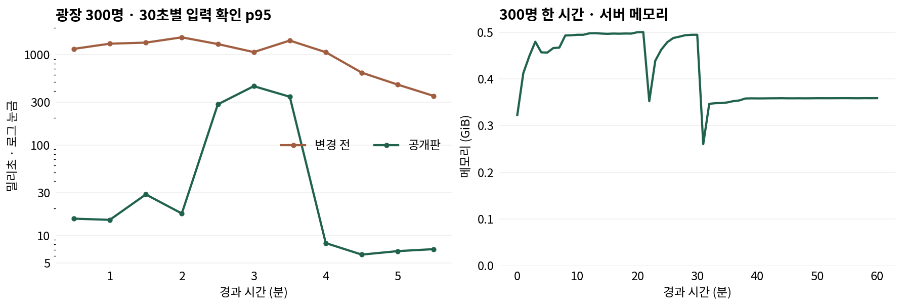

# 초기 공개 검증

후속: 정적 파일 압축·캐시와 글꼴 분할로 첫 접속을 개선했다. 아래 부하 실험은 당시 결과를 보존하며, 최신 초기 파일 측정과 원가는 [후속 검증](FIRST_VISIT_RELEASE.md)과 [원가 모형](OPERATING_COST_MODEL.md)을 따른다.
2026-11-26 · 부하 시험 서버 [9f4ac24](https://github.com/neocjmix/textworld/commit/9f4ac24) · [공개 지도](https://textworld-production-987c.up.railway.app/) · [원자료](measurements/initial-release-2026-11-26/) · [원가 계산기](https://textworld-production-987c.up.railway.app/cost.html)

**단일 서버 300석으로 초기 공개할 수 있다.** Railway 프로덕션은 미국 서부 한 리전의 한 인스턴스다. 브라우저와 HTTP·MCP 에이전트가 300석을 공유한다. 작성·이동 비율을 가정하고, 밀집 광장과 접속 교체, 실제 풍화와 크기 변경을 함께 시험했다. 1,000명 표본은 공개 상한 결정에서 제외했다.

## 같은 부하에서 달라진 점

| 인원·조건 | 예정 입력→ACK p95 | 다른 독자 수신 p95 | 서버 전송 준비 p95 | 교체 접속 p95 | 실시간 MB/s | CPU 코어 | 평균 RSS GiB |
| --- | ---: | ---: | ---: | ---: | ---: | ---: | ---: |
| 300 분산 · 변경 전 | 364ms | 466ms | 305ms | 880ms | 2.296 | 0.410 | 0.468 |
| 300 분산 · 공개판 | 7ms | 57ms | 55ms | 39ms | 0.457 | 0.126 | 0.359 |
| 300 광장 · 변경 전 | 1181ms | 1369ms | 285ms | 1726ms | 8.473 | 0.600 | 0.648 |
| 300 광장 · 공개판 | 25ms | 68ms | 58ms | 58ms | 2.513 | 0.224 | 0.619 |
| 300 광장 25% · 공개판 1시간 | 6ms | 56ms | 55ms | 27ms | 0.552 | 0.116 | 0.416 |
| 1,000 광장 25% · 로컬 진단 | 127ms | 263ms | 139ms | 448ms | 3.312 | 0.445 | 0.746 |

MB/s는 초당 100만 바이트다. 예정 입력→ACK는 발생기의 지연까지 포함한다. 다른 독자 수신은 정지한 다른 클라이언트가 디코딩한 표시 가능한 글자 버전을 작성자의 확정 순번과 대응한 값이다. 실제 인터넷·그리기는 아래 브라우저 수치에서 확인할 수 있다. 공개판의 정상 부하는 서버 전송 준비 p95 100ms, 예정 입력→ACK와 다른 독자 수신 p95 150ms, 접속 교체 p95 1초를 기준으로 판단했다. 정상 부하에서 비계획 종료, 배출 후 미확인 입력, 관측 순번 공백도 확인했다. [이전 검증 기준](SCALING_VALIDATION.md)

광장 300명에서 다른 독자 수신 p95는 95.0%, WebSocket 본문 송신은 70.3% 감소했다. 광장 시험의 공개판 입력 확인 p99는 432ms, 가장 느린 30초 구간의 p95는 450ms였다. 변경 전 가장 느린 같은 길이 구간의 p95는 1560ms였다.



로컬 비교는 Node 24.22.3, 4 vCPU 할당의 같은 기계에서 파일 SQLite와 발생기를 별도 프로세스로 실행했다. 각 6분 시험은 512×256에서 시작했고, 이전 180초에 작성된 것으로 배치한 글자 6,000개 중 75%가 두 칸 글자였다. 작성자 6명은 1인당 초당 평균 3회 한글·한자·영문·이모지·공백·줄바꿈을 입력했다. 24명은 이동하고 270명은 읽었다. 4분의 1이 150×50, 나머지가 52×40 시야를 사용했다. 고정 시드로 행동 예정 시각·배치·교체 순서를 만들었고, 입력 확인을 기다리지 않고 전송했다. 크기 변경은 제품의 실제 밀도 판단과 무작위 절단 위치를 사용하므로 실행별 세계의 모양과 변경 횟수에는 차이가 있다. 전원 광장 출발은 처음 33×17칸에 모인 뒤 자연스럽게 움직이는 조건이다.

## 무엇을 바꾸었나

1. 신선도가 바뀐 버전과 사라진 삭제 흔적만 전송한다. 실제 삭제는 서버가 버전을 확인하고 수행한다. 좌표별 작성 시간을 추가로 저장하거나 공개하지 않는다.
2. 크기 변경 때 점유 셀과 커서의 공개 표현을 한 번 준비한다. 자동 변경으로 시야 전체가 같은 거리만큼 이동했다는 증명이 있을 때 해당 셀을 재사용한다. 나머지는 참가자의 실제 새 시야를 다시 비교한다. 기존 WebSocket의 버전 협상으로 직전 관측을 참조하고, 기준 순번이 어긋나면 전체 스냅샷으로 복구한다. 먼저 확정한 덮어쓰기와 커서 변경을 모두 보내고 입력 순번·네이티브 조합 상태를 같은 경계에서 보정한다.
3. 300석이 차면 신규 입장에 503과 5초 재시도 시간을 준다. 브라우저는 지터가 있는 재접속 지연을 사용한다. 송신 대기량이 2MiB를 넘는 느린 연결은 1013으로 닫고 읽지 않는 상대는 1.5초 뒤 정리한다. 전체 행동 예산은 초당 120단위·순간 96단위다. 글을 쓰거나 지울 때 해당 16×16칸 타일을 구독하는 시야가 70개를 넘으면 예상 전파량에 비례해 최대 5배까지 차감한다. 읽기와 확정된 글의 전파는 계속된다. 과도한 동시 행동은 변경 이전에 429 `WORLD_BUSY`로 돌려준다. 개인별·접속 주소별 한도도 따로 적용한다. [결정 기록](DECISIONS.md)

## 한 시간과 과부하

- **지속 시험**은 300명 중 25%가 광장에서 출발했다. 107,999회 입력·이동 중 107,999회가 확인됐다. 900회 접속을 교체했고 비계획 종료 0회, 배출 후 미확인 0회였다. 관측 순번 공백 0회, 역행 0회, 크기 변경의 기준 불일치 0회였다.
- **관측 대조**는 장시간 연결된 독자 네 자리에서 수행했다. 같은 순번에서 전체 시야를 192회, 강제 관측 중 시계가 전진한 경우 위치와 셀을 44회 비교했다. 대조한 항목은 모두 일치했다. 고정 시야 대조에서는 예상한 다른 독자 쓰기 누락 0건, 범위 밖 글 노출 0건이었다. 한 시간 동안 소켓이 닫히거나 더 쓸 수 없어 배출되지 않은 대기 관측은 79건이었다. 이 수치에는 자발적 퇴장이 포함된다. 연결 종료 경계의 중간 기록까지 모든 참여자에 대해 대조하지는 않았다.
- **풍화·공간.** 서버가 한 시간 동안 글자 55,255개를 자동 삭제했다. 공유 시각 기준 삭제 나이 p95는 190.0초였다. 한 시간 중 확장 0회·축소 8회였고, 512×256에서 333×151로 바뀌었다. 마지막 30분 프로세스 RSS의 관측 범위는 0.26~0.49GiB였다. 300개의 읽기 연결을 유지하고 입력을 멈춘 뒤 510초에 남은 잉크 0칸, 이력 0행, 작업 영수증 0행이었다. SQLite가 재사용할 빈 페이지는 11.9MiB였다.
- **활동 급증**에서는 300명의 광장에서 작성자를 6→75→6명으로 바꿨다. 제시한 13,399회 중 4,983회를 승인하고 8,416회에 429 `WORLD_BUSY`를 반환했다. 90초 표본의 대기 입력은 단순 횟수 한도에서 5,549건이었고 밀집도를 반영한 뒤 0건이었다. 이 구간의 입력 확인 p95는 28.6초에서 112ms로 줄었다. 기타 오류는 0건, 비계획 종료 0건, 배출 후 미확인 0건이었다. 거절된 행동은 저장되지 않는다. 만석에서 추가 HTTP 입장을 시도하자 서버가 `503 WORLD_FULL`과 `Retry-After: 5`를 반환했다.
- **1,000명**은 벤치마크 프로세스 안에서만 좌석을 1,000개로 올려 180초 실행했다. 다른 독자 수신 p95 263ms, 재입장 p95 448ms, 승인 17,314/18,005회, 429 `WORLD_BUSY` 691회였다. 전송 준비 p95 139ms와 다른 독자 지연이 공개 목표를 넘었으므로 1,000석 증설은 보류했다.

## 실제 Railway 지도

공개판은 실제 Railway 서비스에서 298개 운영자 봇과 서로 다른 Chromium 브라우저 두 대를 연결했다. 실행은 설정한 440초에 정상 종료됐다. 봇 입장 599회 시도 중 590회 성공, 수명 만료 295회, 입력·이동 확인 15,149/15,149회, 행동 거절 0회, 봇 ACK p95 27ms였다. 러너는 연결 오류 9회를 셌고, 입장 단계에서 거절된 소켓도 9개였다. 같은 시간의 서비스 계수와 만원 응답은 신규 입장 제한이 작동했음을 보여준다. 공개 주소를 거친 브라우저의 전체 입력→상대 캔버스 표본은 40/40개였다. 300명인 순간에 포착한 12개 표본의 로컬 그리기 p95는 19ms, 상대 그리기 p95는 215ms였다. 운영 세계는 32×16에서 시작해 종료 시점에 278×139였다. 글꼴을 로드한 Chromium과 이 회선에서 측정한 값이다.

봇은 동일 서비스의 운영자 전용 루프백 소켓으로 참가했다. 봇이 받은 441.4MiB를 Railway의 공개 송신 청구량에 더하지 않았다. 이 실행의 리소스 기반 소계는 $0.0026였고, 실제 외부 고객에 대한 월 추정에는 아래와 같이 모든 참가자에게 나가는 바이트를 적용한다. Railway 자체 계측의 실행 내부 30초 표본에서 CPU 평균 0.196코어, 메모리 0.407GB, 외부 송신 합계 0.0391GB가 기록됐다. 운영 봇 발생기도 이 컨테이너에 포함된다. [운영 표본](measurements/initial-release-2026-11-26/railway-9f4ac24.json)

같은 공개 월드에서 별도로 60.0분간 유입·휴지·재방문을 실행했다. 참가 봇은 최대 298명, 입장 865회였으며 실제 수명 만료는 550회였다. 입력·이동 32,742회 중 32,742회 확인, 거절 0회, 전송 오류 0회였다. 운영 분 단위 기록에서 확장 34회, 축소 39회, 자동 삭제 18,032칸을 확인했다. 봇이 떠난 6분 동안 지도가 32×16까지 줄었고, 돌아온 뒤 147×76까지 커졌다. 운영자 루프백 송신을 제외한 사용료 추정 소계는 $0.0066다. [프로덕션 한 시간 원자료](measurements/initial-release-2026-11-26/railway-hour.json) · [수명·예산·시나리오](../experiments/playtest/release-hour.json)

## 예상 원가와 운영 판단

| 300명 활동 가정 | 실시간 송신 / 30일 | 정적 파일 / 30일 | 서버·볼륨 / 30일 | 30일 합계 | 7일 합계 | 이용 1,000시간당 |
| --- | ---: | ---: | ---: | ---: | ---: | ---: |
| 1시간 지속 시험의 활동이 이어짐 | $71.60 | $38.44 | $6.77 | **$116.82** | $27.26 | $0.541 |
| 분산 출발 조건 24시간 | $59.26 | $38.44 | $6.37 | **$104.08** | $24.28 | $0.482 |
| 분산 18시간 + 전원 광장 출발 6시간 | $125.86 | $38.44 | $7.56 | **$171.86** | $40.10 | $0.796 |
| 전원 광장 출발 조건 24시간 | $325.65 | $38.44 | $11.12 | **$375.22** | $87.55 | $1.737 |

7일과 30일 비용은 실제 사용률이 그대로 이어진다는 추정이다. 한 시간 동안 측정한 평균은 실시간 0.552MB/s, CPU 0.116코어, RSS 0.416GiB였다. 방문당 123,350바이트의 지도 자산과 5,315,944바이트의 폰트를 확인했다. 평균 체류 20분, 방문 중 20%의 폰트 재전송, 평균 동접 300명은 가정이다. 송신 본문에는 WebSocket/TLS 헤더·재전송이 빠져 있다. 서드파티 전송 할인은 적용하지 않았다. [계산식과 한도](OPERATING_COST_MODEL.md)

## 남은 위험과 재검토 시점

- 느린 회선에서의 완전한 재접속, 실제 모바일 OS·장거리망에서의 그리기 꼬리 지연, 지역별 활동률은 초기 공개 후 표본을 수집한다. 특히 넓은 시야와 재동기화가 반복될 때의 꼬리 지연, 여러 날 운영할 때의 볼륨과 메모리 추이를 추적한다.
- 폭이 큰 시야가 많고 여러 좌표가 잘리는 경우에는 새 셀을 비교하는 비용이 남는다. 밀집·리사이즈의 p95 또는 활성 연결 이탈이 이 표본보다 계속 나빠질 때 공유 인코딩·부분 압축을 다시 비교한다. 상한 증설 전에는 목표 인원과 실제 작성률로 한 시간 시험을 새로 수행한다.
- 사용료의 큰 변수는 시간대별 동접, 같은 위치에 모이는 사람 수, 폰트 캐시 적중률이다. Railway 워크스페이스의 소프트 알림 $50, 하드 한도 $100가 당시 설정돼 있었다. 평균 동접 300명이 지속되면 분산 출발 조건에서도 월 예상 사용료가 현재 하드 한도를 넘는다. 같은 워크스페이스의 다른 사용량·플랜 최소액·세금·백업도 실제 지불액에 영향을 준다. 장기 P2P·다중 서버의 절감률은 이 원가에 포함하지 않았다.
- 다음 실험은 실제 초대 방문자의 첫 글 작성률, 상대 글을 본 뒤 답한 비율, 1주 재방문율과 이들의 체류·밀집 분포를 함께 관찰하는 것이다. 공개 상한은 300석으로 유지한다.

## 공개판 회귀 확인

Node 자동 시험 273개가 통과했다. Chromium에서는 한글 조합·재변환, CJK 두 칸 글자, 연속 입력, 공간 커서, 월드 크기 변경, 신선도 표시와 스크롤을 확인했다. 모바일 키보드는 새 캔버스 높이가 반영될 때 목표를 정하도록 고쳤다. 공개 지도에서 가시 높이를 440px로 줄이자 커서는 위에서 384px에 정착했다. [모바일 공개 검증·전송 크기](measurements/initial-release-2026-11-26/public-assets-742a32f.json)

비용 계산기는 공개 HTTPS에서 390px와 1,200px 폭으로 검증했다. 공개 지도가 새 버전의 WebSocket에서 관측 프레임을 받는지도 확인했다. 배포 전환을 확인하는 도중 상태 조회 한 번이 6초 안에 돌아오지 않았고, 이후 지도·WebSocket·계산기에서 정상 응답을 받았다.

드래그 중에는 화면 커서가 입력 주소를 90ms 시간 상수로 따라간다. 예전 브라우저 시험은 이동 중에도 두 위치가 0.1px 안에서 일치해야 한다고 가정했다. 이번 변경 전 코드에서도 같은 검사가 실패했다. 시험은 매 프레임 입력 목표가 실제 칸에 붙는지, 표시 커서가 화면 안에 있는지, 정지 후 둘이 0.1px 안에서 일치하는지를 검사하도록 고쳤다. [커서 추종 설계 기록](DECISIONS.md#2026-11-03--커서-추종을-조금-더-빠르게)

## 재현

Node 24에서 저장소 루트의 명령을 실행한다. 비교 대상 코드는 `CAPACITY_TARGET_ROOT`로 별도의 체크아웃을 선택할 수 있다. 부하 발생기의 대상은 로컬 루프백으로 고정된다. 운영자 시험은 별도 인증과 만료 시간·봇분·바이트 예산을 사용한다. [재현용 발생기](../experiments/release-capacity.mjs) · [프로덕션 시나리오](../experiments/playtest/release-300.json)

```sh
node experiments/check-release.mjs docs/measurements/initial-release-2026-11-26
node experiments/release-capacity.mjs 300 360 0 /tmp/spread.json
node experiments/release-capacity.mjs 300 360 1 /tmp/plaza.json
CAPACITY_QUIET_SECONDS=510 node experiments/release-capacity.mjs 300 3600 .25 /tmp/hour.json
CAPACITY_WRITERS=75 CAPACITY_SURGE=1 node experiments/release-capacity.mjs 300 135 1 /tmp/surge.json
```
