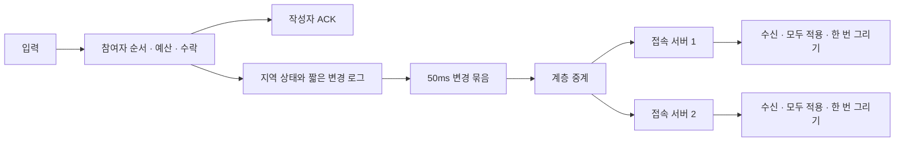

# 모든 변경을 받되 매번 따로 받지는 않는다

2026-11-16. **설계 수정과 독립 통신 실험이다. 운영 서버 적용·분산 처리량 검증은 아직 하지 않았다.**

OT·CRDT·WebRTC 자료까지 종합한 전체 구조와 두 쓰기 처리안의 비교는 [최종 설계 제안](FINAL_ARCHITECTURE_PROPOSAL.md)에 있다. 이 문서의 모든 변경을 묶어 전달하는 계약은 두 안에 공통으로 적용한다.

적용 순서는 [트래픽 수준별 단계](SCALING_ROADMAP.md)를 따른다. 묶음 전달과 시야별 갱신을 기존 단일 앱에 먼저 적용하며, 여러 세계 worker와 게이트웨이는 실제 병목에 맞춰 나중에 분리한다.

## 판단 수정

사용자는 대규모 영상 스트리밍 채팅을 참고하도록 했고, “다 받긴 해야 하는데 매번 받진 않아도 된다”고 정정했다. 이를 정상적인 현재 시야 구독에서 변경을 생략하지 않고 묶어 전달한다는 기준으로 반영한다. 모든 입력이 전 세계 모든 사람에게 보인다는 뜻은 아니다. 기존 시야·행동 한도와 429는 유지한다.

앞선 설계에는 두 가지 오류가 있었다. 최종 상태를 합칠 수 있다는 이유로 중간 사건을 생략하는 전달 계약을 먼저 선택했고, 모든 접속자가 계속 입력하는 최악 부하를 일반화해 군중 집계를 권장했다. 현재 설계는 **전체 변경의 묶음 전달과 개별 커서 유지**다. 최종 상태 병합은 내부 저장/수렴 알고리즘으로 사용할 수 있지만 구독 변경의 삭제 근거로 쓰지 않는다. 헌법은 변경하지 않았다.

## 비교한 계약

| 방식 | 수신 내용 | 판단 |
| --- | --- | --- |
| 사건마다 관측 재계산·별도 전송 | 모든 변경 | 현재 병목을 재생산한다. 선택하지 않는다. |
| 짧은 시간의 변경을 모두 묶음 | 모든 변경, 수신 후 한 번 그리기 | **기본안.** 입력률과 관측 스케줄링 빈도를 분리한다. |
| 같은 칸/커서의 마지막 변경만 묶음 | 최근 상태, 중간 사건 일부 없음 | 별도 실험 후보. “전부 전달”과 같다고 설명하지 않는다. |
| 커서 일부만 보내거나 군중으로 집계 | 일부 개인 또는 집계 상태 | 기본안에서 제외. 확장성 때문에 먼저 요구하지 않는다. |

“받는다”와 “매번 그린다”도 다르다. 한 묶음에 `가 → 나 → 다`가 들어오면 세 변경을 모두 적용하고 `다`를 그릴 수 있다. 각각을 화면에 한 프레임씩 재생할 필요는 없다. IME 초안이나 개인 편집 문맥을 다른 사용자에게 공개한다는 의미도 아니다.

## 참고한 실제 서비스

- YouTube의 [liveChatMessages.list](https://developers.google.com/youtube/data/live/reference/rest/v3/liveChatMessages/list)는 메시지 배열, `nextPageToken`, `pollingIntervalMillis`를 반환한다. 배열 안의 메시지는 오래된 것부터 정렬된다. 최초 조회 이전의 모든 과거 채팅을 보장하지 않는다.
- [streamList](https://developers.google.com/youtube/data/live/reference/rest/v3/liveChatMessages/streamList)는 지속 연결에서 메시지 배열을 보내며 마지막 토큰으로 재접속할 수 있다. 이 API의 내부 버퍼링 주기나 YouTube 웹 UI의 구현까지 공개한 자료는 아니다.
- Twitch의 [2023년 기술 소개](https://blog.twitch.tv/en/2023/09/28/twitch-state-of-engineering-2023/)는 Edge의 수락/전달, Clue·Zuma의 검증, 구독 Edge로 전달하는 Pubsub를 구분한다. [2015년 소개](https://blog.twitch.tv/en/2015/12/18/twitch-engineering-an-introduction-and-overview-a23917b71a25/)는 Pubsub와 Edge의 계층 fanout을 명시한다. Twitch가 50ms 묶음이나 사건 생략을 사용한다는 근거로 인용하지 않는다.

모두 2026-11-16에 공식 본문을 확인했다. 이 서비스들의 사용자 규모를 Textworld 예상 수용 인원으로 가져오지 않았다.

## 선택한 전달 구조

1. 유효한 입력은 도착할 때 처리한다. 수락 ACK는 구독자의 ACK나 다음 관측 틱을 기다리지 않는다. 실제 분산 구현에서는 선택한 복제/복구 보장을 충족한 뒤 수락을 확정한다. 내 타이핑과 카메라는 로컬에서 즉시 반응한다.
2. 변경을 지역/발행 파티션별 짧은 로그에 둔다. 정상 구독 중의 덮어쓰기·삭제·커서 변경을 모두 묶는다. 입력마다 전체 접속자 목록이나 전체 시야를 순회하지 않는다.
3. 50ms마다 바뀐 지역의 공유 본문을 만들고 중계한다. 내용이 없으면 보내지 않는다. 같은 본문은 연결마다 다시 JSON 인코딩하거나 압축하지 않게 설계한다. 연결별 TLS와 전송 바이트 비용은 별개다.
4. 논리 묶음의 바이트 상한도 둔다. 한 틱에 많이 들어오면 여러 프레임으로 나누어 모두 보낸다. 즉 “틱 20회/초”가 언제나 “네트워크 패킷 20개/초”는 아니다. 여러 작은 묶음의 전송 wakeup도 게이트웨이에서 합칠 수 있다.
5. 수신자는 모든 변경을 적용하고 묶음의 최종 화면을 그린다. 개별 커서를 유지하고 원격 이동은 보간한다. 정상 입력과 과속 429 정책은 묶음 간격에 종속시키지 않는다.

서버 내부 공유 블록이 사용자 시야보다 크면 게이트웨이가 잘라낸다. 완전히 포함된 작은 타일은 재사용하고 경계 타일은 제한된 범위에서 필터링한다. 원시 블록을 브라우저·봇에 모두 내려주지 않는다. 권한 밖 데이터는 압축 사전이나 재접속 캐시로도 노출하지 않는다. 실제로 서로 다른 시야에서 얼마나 공유되는지는 다음 실험의 측정 항목이다.

### 이어받기와 느린 독자

묶음은 스트림 세대, 시작/끝 순번, 배치 버전, 변경 목록을 가진다. 순번은 지역/발행 파티션의 관측 순번이며 전 세계 합의 순서가 아니다. 여러 스트림은 각자의 순번을 유지한 채 전달할 수 있다. 입력 ID와 순서 표식으로 중복·역순을 처리한다.

중복 묶음은 이미 적용한 부분을 건너뛴다. 누락이 있으면 그 뒤를 정상 적용했다고 표시하지 않고 짧은 공유 로그에서 이어받는다. 구독 필터링에는 별도의 순번이나 명시적인 건너뜀 범위를 사용한다. 이동/초기 snapshot의 기준 버전 이후 변경을 이어 붙여 초기화 사이의 누락을 막는다. CJK와 배치 변경의 의존성을 먼저 충족한 다음 보이게 한다.

정상 연결의 사건을 임의로 버려 큐 길이를 감추지 않는다. 공유 보관 범위를 벗어난 연결은 누락을 명시하고 새 snapshot으로 관측을 재시작한다. 이것은 완전 전달 성공이 아닌 `reset-required`다. **무제한 오프라인 이력 보관은 제공하지 않는다.** 느린 연결의 지연·재전송·reset을 기록하고, 연결별 큐 상한과 흐름 제어로 다른 입력 처리까지 막지 않게 한다. 입력의 유실, 관측 이력의 공백, 화면에 중간 상태를 그리지 않음을 서로 다른 지표로 구분한다.

50ms 주기, 예제의 16KiB 프레임 상한과 짧은 보관량은 실험값이다. 실제 복제 로그·네트워크 흐름 제어·snapshot 재시작 UI는 이 실험에 구현하지 않았다.

## 수행한 실험

재현: `node experiments/replication-batching.mjs`. [소스](../experiments/replication-batching.mjs), [결과 JSON](measurements/replication-batching-2026-11-16.json).

9개 검사를 통과했다. 같은 칸의 모든 중간 덮어쓰기와 이동을 보존하고, 바이트 상한으로 묶음을 나누며, 중복·겹치는 재전송을 한 번만 적용했다. 누락 감지 후 이어받기, 보관 범위 밖 명시적 reset, 서로 다른 파티션의 독립 순번도 검사했다. 마지막 상태만 보내는 대안은 동일한 마지막 셀을 만들더라도 전체 사건 전달과 다르다는 반례를 포함했다.

실제 루프백 WebSocket 연결 **2개**에서 각자 **128개 변경을 4개 묶음으로 모두 수신**했다. 두 연결의 전송 합계는 8개 프레임이다. 50ms씩 모은 이 실행의 수락→flush p95는 약 51.7ms였다. 실제 서비스의 저장 ACK·브라우저 화면·인터넷 지연을 측정한 수치가 아니다.

추가로 동일 시야의 JSON 작업량을 계산했다. 아래는 **2초 동안의 결정적 모형**이고 해당 인원을 실제로 접속시키지 않았다. 모든 활동자가 초당 2개 변경을 만들며, 자기 자신의 변경도 공통 스트림으로 받는 것으로 계산한다. 중간 변경 생략·압축·TLS는 없다.

| 관측자 / 활동자 | 수락 변경 | 개별 전송 횟수 | 묶음 전송 횟수 | 개별 / 묶음 JSON 총량 |
| --- | ---: | ---: | ---: | ---: |
| 1,000 / 100 | 400 | 400,000 | 40,000 | 55.33 / 36.80 MB |
| 1,000 / 1,000 | 4,000 | 4,000,000 | 40,000 | 573.65 / 362.00 MB |
| 10,000 / 10,000 | 40,000 | 400,000,000 | 2,400,000 | 60,319.13 / 38,274.33 MB |

MB는 10⁶바이트다. 표의 전송 횟수는 WebSocket application-frame 복사 수이며 TCP/IP 패킷 수가 아니다. 마지막 행에서는 16KiB 상한 때문에 한 논리 틱을 여러 프레임으로 나눴다. 모든 행에서 수신 적용 순서와 전체 원본 변경이 일치했다. 이 표는 특정 예제 JSON의 봉투 비용과 본문 복사를 보여주며 CPU 시간·지원 인원·월 요금의 추정값이 아니다.

활동자 100명을 유지하면서 관측자만 100→1,000→10,000명으로 늘린 모형에서는 전달 바이트가 정확히 관측자 수에 비례했다. 반대로 전원이 계속 입력하는 같은 시야에서는 사건 본문의 수신자별 복사량도 함께 늘었다. **묶음만으로 모든 바이트가 상수가 되지는 않지만, 입력마다 시야 계산·인코딩·전송 호출·렌더를 반복할 이유도 없다.**

## 선형 확장의 검증 기준

서로 다른 입력을 한 곳에 모으는 CPU 병목과 수신자가 소비하는 바이트를 분리한다. 지역 g의 관측자 U_g, 변경 바이트율 B_g라면 전달량은 대략 `Σ(U_g × B_g)`다. 입력 생산/검증은 활동자와 행동률에, 공유 본문 생성은 지역 변경량에, 연결과 전송 스케줄링은 관측자와 갱신 주기에 맞춰 나눈다. 중계 계층은 같은 본문을 공유하고 여러 서버에 전송 책임을 나누지만 최종 수신 바이트 자체를 없애지는 않는다.

관객만 증가하거나 동일 부하의 지역이 늘어나는 경우 선형 확장을 목표로 할 수 있다. 전원이 같은 장소에서 고정 속도로 입력하는 부하는 그와 분리해서 측정한다. 이 특수 부하의 바이트가 제곱으로 증가할 수 있다는 사실을 전체 서비스가 항상 제곱이라는 결론으로 사용하지 않는다. 단순히 관측 간격을 늘려 평균 전달 대역폭 부족을 해결했다고 주장하지도 않는다.

다음 실험은 기존 단일 앱에 이 전달 계약을 적용한 뒤 두 브라우저와 같은 조건의 부하 생성기로 검증하는 것이다. 시야 이동·CJK·크기 변경 중에도 누락 없이 이어져야 한다. 관객이 병목인 단계에서는 세계 담당 하나와 두 게이트웨이의 공유 묶음을 검증한다. 세계 처리 분산이 필요한 단계에서 worker 2개부터 시작해 1/2/4/8 worker와 50/100/200ms 관측 주기를 비교한다. 고정 활동자/관객 증가, 활동자까지 증가, 여러 지역 분산을 별도 조건으로 둔다.

수락/거부 행동 수, 수신 적용 수, 묶음 수·크기, 공유 인코딩 횟수·시간, ACK와 관측 지연, 압축 후 egress, 재전송/reset, 큐 크기, 브라우저 적용/그리기 시간을 기록한다. 정상 구독에서 변경을 생략하거나 갱신 주기를 숨겨 늘려 성공으로 계산하지 않는다. 실제 처리량 효율·운영 비용·밀집 상태에서의 모바일 사용성은 아직 미검증이다.
